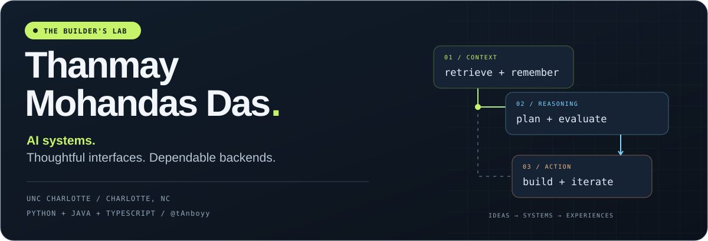

  

  
  
  

  <b>M.S. Computer Science @ UNC Charlotte</b> · Charlotte, NC 
  Generative AI · Backend Engineering · Web &amp; Mobile

---

  

## Hey, I'm Thanmay.

I build **AI-powered applications, dependable backends, and thoughtful interfaces** for learning, fitness, and everyday decisions. I enjoy connecting the whole system—from the interface and API to the data and AI workflows behind it.

  <a href="#selected-builds">Selected builds</a> &nbsp; / &nbsp;
  <a href="#the-rest-of-the-workbench">More projects</a> &nbsp; / &nbsp;
  <a href="#tools-i-reach-for">Tech stack</a>

## Selected builds

### 01 / CourseLab
AI-supported learning in one place: Socratic conversations, reflections, and adaptive tutoring connected through a shared course workflow.

  

---

### 02 / Spotter
An equipment-aware workout companion with session tracking and conversational coaching that helps adapt a workout when a machine is taken. Built with a teammate.

  

---

### 03 / Reflections
Guided AI conversations that help students reflect on how they learn, with persistent context and instructor-configured topics.

  

---

## The rest of the workbench

<b>Open the project shelf — navigation, commerce, productivity, and gym research</b>

### CampusNav / NMAMIT Map
Campus navigation with searchable places, a teacher directory, and offline fallbacks.

[Repository →](https://github.com/tAnboyy/NMAMIT-Guide)

### Cinnamon
A food-ordering app with menu browsing, weekly meal plans, shared carts, and checkout.

[Repository →](https://github.com/tAnboyy/cinnamon_customer-app)

### Hour Tracker
An Android-first app for hourly activity logs, next-hour goals, and productivity summaries.

[Repository →](https://github.com/tAnboyy/hour-tracker-app)

### UREC Live
Connected-fitness apps and scheduling experiments exploring equipment availability and workout flow.

[Repository →](https://github.com/tAnboyy/urec-live-app)

## Tools I reach for

| Area | Technologies |
| :--- | :--- |
| **Languages** | Python · Java · TypeScript · JavaScript · SQL · Kotlin |
| **AI & retrieval** | LangGraph · LangChain · Sentence Transformers · OpenAI API · pgvector · Hybrid Search · Reranking · MCP |
| **AI evaluation** | LangSmith · RAGAS · DeepEval · Azure AI Evals |
| **Backend & APIs** | FastAPI · Spring Boot · Spring Batch · Node.js · REST · WebSockets |
| **Web & mobile** | React · React Native · Expo · Angular · Redux Toolkit · SwiftUI prototyping |
| **Data & storage** | PostgreSQL · Oracle DB · MongoDB · Redis · SQLite · Firebase / Firestore · Supabase |
| **Messaging** | Apache Kafka · RabbitMQ |
| **Delivery & testing** | Azure · Azure DevOps · Docker · Git · CI/CD · Postman · Linux · VMware Tanzu · Red Hat OpenShift |
| **Security & observability** | OAuth 2.0 · JWT · RBAC · Checkmarx · Black Duck · ELK Stack · PCI DSS |

---

  <b>Building around learning, movement, and everyday decisions.</b>  
  Interested in AI engineering, backend systems, or a thoughtful product idea?  
  
  
  

