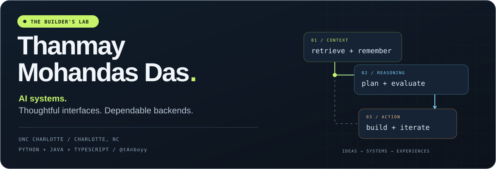

  

  
  
  

  <b>M.S. Computer Science @ UNC Charlotte</b> · Charlotte, NC 
  Generative AI · Backend Engineering · Web &amp; Mobile

---

## Hey, I'm Thanmay.

I build software around questions I keep coming back to: **Can an AI tutor remember where a student struggled? Can a workout adapt when the next machine is taken? Can a complex document become an answer someone can actually use?**

Those questions have taken me from **enterprise backend engineering at ACI Worldwide**, to **agentic learning research at UNC Charlotte**, to **RAG development at Arch MI**. Along the way, I've built campus-navigation tools, mobile apps, and systems for learning and fitness.

I enjoy connecting the whole system: the interface someone touches, the API behind it, the data it depends on, and the AI workflow that helps them take the next step.

> My favorite engineering problems live where AI reasoning meets application state, real constraints, and a useful user experience.

  <a href="#selected-builds">Selected builds</a> &nbsp; / &nbsp;
  <a href="#experience">Experience</a> &nbsp; / &nbsp;
  <a href="#the-rest-of-the-workbench">More projects</a> &nbsp; / &nbsp;
  <a href="#tools-i-reach-for">Tech stack</a>

## Selected builds

### 01 / CourseLab
**A shared home for AI-supported learning.**

CourseLab brings Socratic conversations, academic reflections, and adaptive tutoring into a common course-and-assignment workflow. My work connects the learning tools with the platform infrastructure needed to make them work together.

- **One entry point:** a FastAPI gateway coordinates authentication, course access, assignment configuration, and handoffs between learning services.
- **Grounded conversations:** hybrid retrieval combines dense vector search with PostgreSQL full-text search to bring course evidence into the tutoring flow.
- **Consistent learning context:** published assignments preserve immutable document and configuration snapshots, so later source edits do not silently change the activity.
- **Persistent learning journeys:** saved attempts and stateful workflows let students resume their work; Canvas LTI integration connects the platform to course identity and context.

`Python` `FastAPI` `React` `PostgreSQL / pgvector` `LangGraph` `Docker` `Canvas LTI`

**[Explore CourseLab →](https://github.com/tAnboyy/CourseLab)**

### 02 / Spotter
**A workout plan should survive a busy gym.**

Spotter is an equipment-aware workout companion built around a simple situation: you're ready for the next exercise, but the machine is taken. The project combines workout planning, set and rest tracking, and a conversational coaching interface.

- **State-aware coaching:** ElevenLabs integration uses structured tool calls to connect conversational intent to supported workout actions.
- **A shared source of truth:** a FastAPI workout engine validates actions and synchronizes session updates through WebSockets.
- **Equipment-aware flow:** Taken reports can defer an exercise or offer an approved alternative while keeping the workout state consistent.
- **Across interfaces:** an Expo / React Native experience, a browser watch panel, and a SwiftUI Apple Watch prototype explore different ways to interact during a workout.

*Built with a teammate. Web-first; live-provider and native acceptance checks are tracked separately in the repository.*

`TypeScript` `React Native / Expo` `Python` `FastAPI` `SQLite` `WebSockets` `ElevenLabs` `SwiftUI prototype`

**[Explore Spotter →](https://github.com/tAnboyy/spotter)**

### 03 / Reflections
**Helping students examine how they learn.**

Reflections uses guided AI conversations to support academic reflection. Professors configure the learning experience, while students work through topic-based conversations or connect milestone reflections to relevant historical experiences.

- **Configurable learning:** modules define topics, depth, and probing styles instead of relying on one generic chatbot prompt.
- **Stateful conversations:** LangGraph workflows and PostgreSQL checkpointing preserve conversational context.
- **Relevant past experiences:** sentence embeddings and similarity matching connect student reflections with historical challenges.
- **Reviewable outputs:** reflection evaluations and an analytics interface help instructors inspect the resulting work.

`Python` `FastAPI` `React / Vite` `LangGraph` `PostgreSQL` `Sentence Transformers`

**[Explore Reflections →](https://github.com/tAnboyy/reflections-app)**

## Experience

### Arch Mortgage Insurance Company · Software Engineer Intern
**Jun – Aug 2026 · Greensboro, NC**

Worked on a RAG application for mortgage-insurance underwriters, turning document-heavy information retrieval into a conversational workflow. Explored chunking, hybrid vector-graph search, reranking, and prompt engineering, and created ground-truth datasets and automated Azure AI evaluations to support iteration.

**What I took from it:** retrieval quality and answer quality need to be measured separately; useful AI systems need evidence and evaluation throughout development.

### UNC Charlotte · Research Assistant
**Jan – May 2026 · Charlotte, NC**

Built stateful agentic tutoring workflows with planner, tutor, and evaluator roles using LangGraph. Worked with PostgreSQL checkpoints, conditional routing, prior-session learning context, and RAG-based recommendations using Sentence Transformers and pgvector. Evaluation work included LangSmith, RAGAS, DeepEval, and LLM-as-a-judge workflows, with FastAPI and a Dockerized React application connecting the pieces.

**What I took from it:** a learning conversation becomes more interesting when the system remembers what happened and uses that context to choose what comes next.

### ACI Worldwide · Associate Software Engineer
**Sep 2023 – Jun 2025 · Bengaluru, India**

Contributed to the migration of a Spring MVC monolith into Spring Boot microservices, developed and tested REST APIs, and maintained production services through fixes, upgrades, and SQL scripts. Also worked on Angular interfaces, Postman regression testing, CI/CD on VMware Tanzu and Red Hat OpenShift, and application-security remediation.

**What I took from it:** backend engineering includes everything around the endpoint—testing, deployment, debugging, and keeping existing systems working as they change.

## The rest of the workbench

<b>Open the project shelf — navigation, commerce, productivity, and gym research</b>

### CampusNav / NMAMIT Map

My campus-navigation work began with an Android app built with Java, Kotlin, Google Maps, and Firebase. The broader CampusNav work explores searchable places, a teacher directory, offline fallbacks, university-specific configuration, and a Spring Boot backend with a React administration interface.

**Focus:** making unfamiliar campuses easier to navigate, with useful information available even when connectivity is unreliable.

[Original NMAMIT Guide repository →](https://github.com/tAnboyy/NMAMIT-Guide)

### Cinnamon

A food-ordering project spanning a React Native customer app, Spring Boot API, restaurant administration, and a marketing site. The customer journey includes menu browsing, weekly meal plans, a shared cart, order history, and platform-specific checkout, with Redux Toolkit, Firebase / Firestore, and Stripe integration.

[Customer app →](https://github.com/tAnboyy/cinnamon_customer-app)

### Hour Tracker

An Android-first productivity app pairing hourly activity logs with a goal for the next hour. Local SQLite storage, notification actions, missed-hour backfilling, dashboard summaries, and CSV export keep the core workflow practical; optional Supabase synchronization connects it to a cloud account.

[Repository →](https://github.com/tAnboyy/hour-tracker-app)

### UREC Live & gym scheduling research

Connected-fitness work across a member app, Spring Boot services, and gym administration. A related Python / SimPy simulation workspace explores equipment contention, advisory scheduling, and what changes when people accept or decline recommendations.

**Research interest:** testing scheduling assumptions through reproducible experiments before drawing conclusions about a real gym.

### Incridea

Collaborated in a six-person team on an event platform using React, Node.js, Firebase, and Razorpay. Worked across the frontend, backend APIs, authentication, and payment integration.

## The engineering questions I care about

| Question | Where it shows up in my work |
| :--- | :--- |
| **What evidence supports this answer?** | RAG, hybrid retrieval, reranking, and evaluation datasets. |
| **What should the system remember?** | LangGraph workflows, PostgreSQL checkpoints, and prior-session context. |
| **Can an AI action safely change application state?** | Structured tools, validated workout actions, and synchronized sessions. |
| **What happens when conditions change?** | Busy equipment, interrupted conversations, offline access, and evolving course materials. |
| **How do we know it works?** | API regression tests, LLM evaluation, reproducible simulations, and explicit validation notes. |

## Tools I reach for

| Area | Technologies |
| :--- | :--- |
| **Languages** | Python · Java · TypeScript · JavaScript · SQL · Kotlin |
| **AI & retrieval** | LangGraph · LangChain · Sentence Transformers · OpenAI API · pgvector · Hybrid Search · Reranking · MCP |
| **AI evaluation** | LangSmith · RAGAS · DeepEval · Azure AI Evals |
| **Backend & APIs** | FastAPI · Spring Boot · Node.js · REST · WebSockets |
| **Web & mobile** | React · React Native · Expo · Angular · Redux Toolkit · SwiftUI prototyping |
| **Data & storage** | PostgreSQL · SQLite · Firebase / Firestore · Supabase |
| **Delivery & testing** | Docker · Git · CI/CD · Postman · Linux · VMware Tanzu · Red Hat OpenShift |

## Education

**University of North Carolina at Charlotte**  
M.S. in Computer Science · Aug 2025 – Dec 2026 (expected)

**NMAM Institute of Technology**  
B.E. in Information Science · 2019 – 2023

---

  <b>Building around learning, movement, and everyday decisions.</b>  
  Interested in AI engineering, backend systems, or a thoughtful product idea? 
  <a href="mailto:mdasthanmay@gmail.com">Let's talk</a> ·
  <a href="https://tanboyy.github.io">See my portfolio</a> ·
  <a href="https://www.linkedin.com/in/thanmay-m-das-676240193/">Connect on LinkedIn</a>

